# rupaka


<!-- WARNING: THIS FILE WAS AUTOGENERATED! DO NOT EDIT! -->

rupaka (रूपक) means a form, a play that the audience sees, and the figure of speech that shows one thing through another.

A rupaka demo is one interactive figure that teaches one idea. You write it as a JSON spec of small blocks: sliders, plots, 3D scenes, flows, and a gate that asks the learner to predict first.
Python checks the spec ([`validate`](https://vedicreader.github.io/rupaka/spec.html#validate)), and a small runtime draws it in the browser with no network. A model can write a spec for you ([`author`](https://vedicreader.github.io/rupaka/agent.html#author)), because a spec cannot run code.

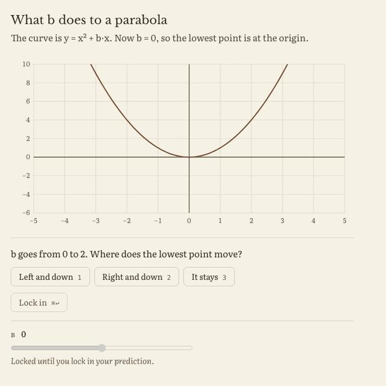

## Install

``` sh
uv add rupaka        # or: pip install rupaka
```

The headless check ([`check`](https://vedicreader.github.io/rupaka/check.html#check)) needs playwright: `uv add "rupaka[check]"`. It uses the Chromium that `playwright install chromium` gives, or the browser in `$FASTCDP_CHROME`. It never runs your everyday Chrome.

## A demo in one minute

Build the spec with the Python builders. You can also write the same thing as JSON.

``` python
from rupaka.spec import *
```

This demo asks for a sum. The answer and the sliders wait for the prediction.

``` python
d = demo('sum', 'Add two numbers', ask='Predict the sum before you see it.', state=dict(a=2, b=3), derive=[expr('a + b', 'sum')],
         blocks=[gate('s', 'What is {a} + {b}?', [4, 5, 6], 'sum', why='Say why, in one line.', context='For a = {a} and b = {b}:'),
                 readout('{a} + {b} = {sum}', after='s'),
                 row(slider('a', 'a', 0, 9, 1, lock='s'), slider('b', 'b', 0, 9, 1, lock='s'))])
```

[`validate`](https://vedicreader.github.io/rupaka/spec.html#validate) gives the errors. An empty list means that the spec is good.

``` python
assert validate(d) == []
```

A readout that shows the sum before the gate breaks the think rule, so [`validate`](https://vedicreader.github.io/rupaka/spec.html#validate) refuses it:

``` python
bad = {**d, 'blocks': [d['blocks'][0], readout('{a} + {b} = {sum}')]}
assert any('wait' in e or 'after' in e for e in validate(bad))
```

`save(d, 'sum.html')` writes one page that works from `file://`. Open it in a browser. Before the lock in, the sum is hidden. After it, the learner sees the result and can move the sliders:

| before the prediction | after the prediction |
|----|----|
| 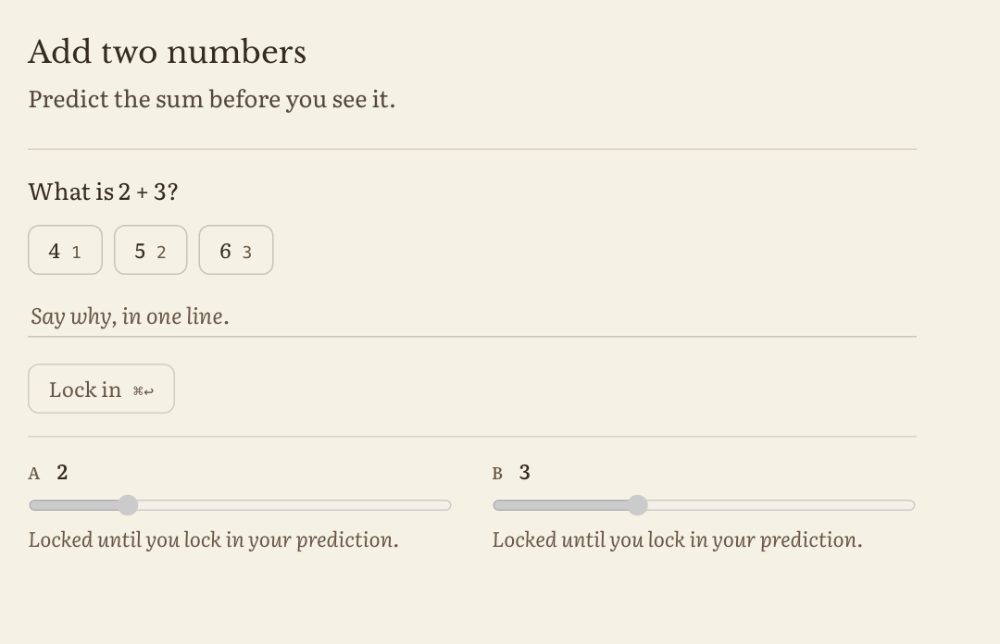 | 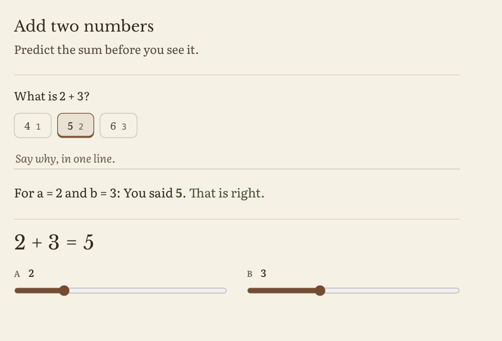 |

The page functions are in `rupaka.render`:

``` python
from rupaka.render import *
```

`page(d)` gives the same page as a string:

``` python
assert '<script' in page(d)
```

## More examples

### Predict, then move a slider

A plot of a curve. The lowest point and the caption wait for the gate, and the slider is locked until the lock in. The animation at the top of this page is this demo.

``` python
p = demo('parabola', 'What b does to a parabola', ask='The curve is y = x² + b·x. Now b = 0, so the lowest point is at the origin.',
         state=dict(b=0), derive=[expr('x^2 + b * x', 'curve', over=dict(x=[-5, 5, 101])), expr('-b / 2', 'vx'), expr('-(b^2) / 4', 'vy')],
         blocks=[axis([-5, 5], plot('curve'), point(x='vx', y='vy', label='lowest', after='move'), y=[-6, 10], height=300),
                 gate('move', 'b goes from 0 to 2. Where does the lowest point move?', ['Left and down', 'Right and down', 'It stays'],
                      is_('Left and down'), hides=['vx', 'vy']),
                 slider('b', 'b', -4, 4, 0.5, lock='move'),
                 caption('The lowest point is at x = −b / 2 = **{vx:2}**. Set b to −2. Where does the point go now?', after='move')])
assert validate(p) == []
```

### A 3D scene

A [`scene`](https://vedicreader.github.io/rupaka/spec.html#scene) holds bodies, forces, labels and camera shots. The force arrow shows the answer, so it waits for the gate.

``` python
s = demo('lift', 'Twice the weight', state=dict(step=1, cam='wide', w=4), derive=[expr('w * 2', 'up')],
         blocks=[gate('g', 'What is twice {w}?', [6, 8], 'up'),
                 scene(body('base', 'box', [2, 1, 2]), force([0, 1, 0], 'up', on='base', at=[0, 1.5, 0], label='lift, {up}', after='g'),
                       shot(bind='cam'), shot('close:base', step=2), bind='step', steps=['A box.', 'Look closer.'])])
assert validate(s) == []
```

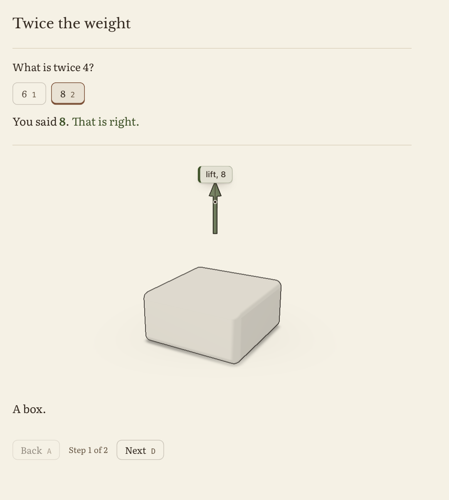

### A worked example and a flow

An explainer (`mode='learn'`) has no gate. It builds one step at a time: the host moves on with `Rupaka.set(el, {step: n})`. A [`pair`](https://vedicreader.github.io/rupaka/spec.html#pair) is one row of a worked example, and a [`flow`](https://vedicreader.github.io/rupaka/spec.html#flow) is a few boxes with arrows.
`page(panel, theme='paper')` gives the paper look.

``` python
panel = demo('targets', 'Make a question and its answer', mode='learn', state=dict(step=1),
             blocks=[pair(['[18]'], '47', heads=['Input tensor', 'Target'], step=1), pair(['[18, 47]'], '56', step=2),
                     flow([dict(id='g', text='Guess'), dict(id='c', text='Compare'), dict(id='a', text='Adjust')], step=3)])
assert validate(panel) == []
```

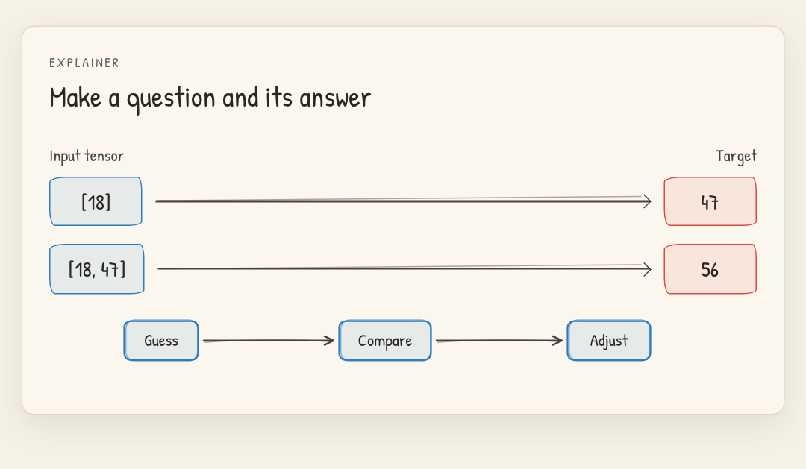

### A board with a side panel

`rupaka.board` is the board of the screen guide. A model writes one JSON line for each mark: a step with a spoken line, marks on the page, and a side panel.
[`parse_board`](https://vedicreader.github.io/rupaka/board.html#parse_board) checks each line against what the page has. A bad line drops. The model never sends HTML or script.

``` python
from rupaka.board import parse_board, clean_context
```

The page tells the board its parts (anchors). Here it has one passage:

``` python
text = 'A search engine splits the query into words. It finds the pages that match and makes a ranked list. Then it shows the top results.'
ctx = clean_context(dict(anchors=[dict(id='p1', kind='passage', text=text)]))
```

Each step says one line, marks the passage and adds boxes to a flow in the side panel:

``` python
lines = """{"op": "step", "say": "First the engine splits the query into words."}
{"op": "underline", "at": {"a": "p1", "text": "splits the query into words"}}
{"op": "panel", "head": "How a search works"}
{"op": "node", "id": "q", "text": "Query"}
{"op": "node", "id": "w", "text": "Words"}
{"op": "edge", "from": "q", "to": "w"}
{"op": "step", "say": "Then it finds the pages that match and makes a ranked list."}
{"op": "circle", "at": {"a": "p1", "text": "ranked list"}}
{"op": "node", "id": "p", "text": "Pages that match"}
{"op": "edge", "from": "w", "to": "p"}
{"op": "node", "id": "r", "text": "Ranked list"}
{"op": "edge", "from": "p", "to": "r"}
{"op": "step", "say": "Last, it shows the top results."}
{"op": "box", "at": {"a": "p1", "text": "the top results"}}
{"op": "node", "id": "t", "text": "Top results"}
{"op": "edge", "from": "r", "to": "t"}"""
board = parse_board(lines, ctx)
assert len(board.steps) == 3 and not board.dropped
```

The page draws it with `rupakaBoard.play(board)`, from the script `rupaka.board.bundle('js')` and the style `bundle('css')`:

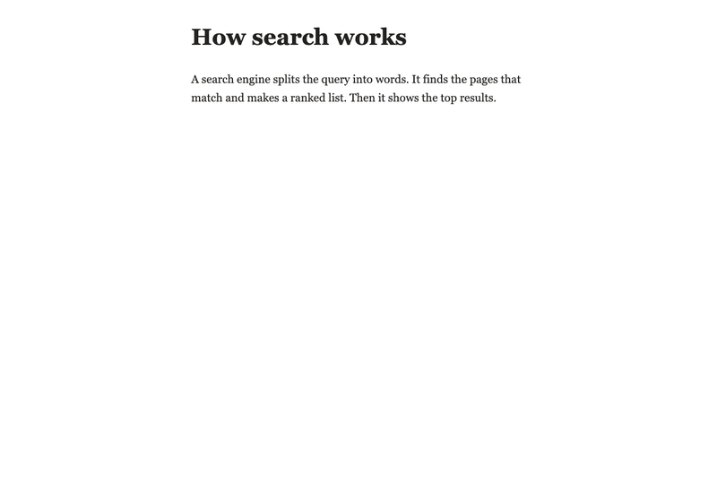

A panel can also be a table, a list, a faded example with blanks, a card of a wrong idea, or three stages (see the [board docs](https://vedicreader.github.io/rupaka/board.html)).

### Plain English

[`plain_why`](https://vedicreader.github.io/rupaka/spec.html#plain_why) finds the parts of a text that are hard to read: long sentences, a reading grade over 9, semicolons, vague words and nicknames. It needs no model.

``` python
why = plain_why('The model, which was trained on a very large amount of text from many sources over many weeks, uses attention; it is good.')
assert any('semicolon' in w for w in why) and any('grade' in w for w in why)
```

`plain_errors(spec)` checks all the texts of a demo.

``` python
assert plain_errors(d) == []
```

## Make a demo with a model

`author(concept, ask)` asks a model for a demo, then validates it, plays it in a headless browser and repairs it. `ask(prompt, sp)` is any function that sends a prompt and a system prompt to a model and gives back text. For example, with the `rishi` package:

``` python
from rishi import Chat, resp_text
from rupaka.agent import author
spec = author('compound interest', lambda p, sp: resp_text(Chat('claude/sonnet', sp=sp)(p)))
```

[`author`](https://vedicreader.github.io/rupaka/agent.html#author) gives a spec that passes all the checks, or `None`. See the [agent docs](https://vedicreader.github.io/rupaka/agent.html) for a live run.

## Put a demo in a page

| where | how |
|----|----|
| a notebook (leela, Jupyter) | `show(spec)`: an HTML output in a sandboxed frame, and the `application/vnd.rupaka+json` mime |
| Markdown | `md(spec)` writes a ```` ```rupaka ```` fence; `md(spec, frame=True)` writes a frame that leela draws today |
| a FastHTML page | `Demo(spec)` and `Assets('/rupaka')`; serve `bundle('js')` and `bundle('css')` at that prefix |
| a file | `save(spec, 'demo.html')` writes one page that works from `file://` with no network |

`check(spec)` draws the demo in headless Chromium and plays it.

A FastHTML app serves the runtime at a prefix and puts the demo in a route:

``` python
from fasthtml.common import *
from rupaka.render import Demo, Assets, bundle

app, rt = fast_app(hdrs=Assets('/rupaka'))

@rt('/rupaka/{name}')
def get(name: str):
    kind = {'rupaka.js': 'js', 'rupaka.css': 'css', 'three.js': 'three'}[name]
    return Response(bundle(kind), media_type='text/css' if kind == 'css' else 'text/javascript')

@rt('/')
def index(): return Titled('Add two numbers', Demo(d))
```

A static site can use `save(spec, 'demo.html')`, or put `host(spec)` (a `div` with the spec in it) in a page that loads `rupaka.js` and `rupaka.css`.

## The blocks

| block | what it does |
|----|----|
| [`gate`](https://vedicreader.github.io/rupaka/spec.html#gate) | asks one question and hides the result until the learner locks in a prediction |
| [`readout`](https://vedicreader.github.io/rupaka/spec.html#readout) | shows one large line from a template, for example `{a} + {b} = {sum}` |
| [`caption`](https://vedicreader.github.io/rupaka/spec.html#caption) | explains the result after the reveal, and ends with a new question |
| [`slider`](https://vedicreader.github.io/rupaka/spec.html#slider), [`toggle`](https://vedicreader.github.io/rupaka/spec.html#toggle), [`choice`](https://vedicreader.github.io/rupaka/spec.html#choice) | change a number, turn a thing on or off, pick one case |
| [`wheel`](https://vedicreader.github.io/rupaka/spec.html#wheel), [`ranklist`](https://vedicreader.github.io/rupaka/spec.html#ranklist) | pick one item on a ring; drag rows to change an order |
| [`axis`](https://vedicreader.github.io/rupaka/spec.html#axis), [`plot`](https://vedicreader.github.io/rupaka/spec.html#plot), [`point`](https://vedicreader.github.io/rupaka/spec.html#point) | axes with a curve or dots, and a dot that the learner can drag |
| [`bars`](https://vedicreader.github.io/rupaka/spec.html#bars), [`grid`](https://vedicreader.github.io/rupaka/spec.html#grid), [`pixels`](https://vedicreader.github.io/rupaka/spec.html#pixels) | bars of a list, a heatmap, a grey image of rows of numbers |
| [`row`](https://vedicreader.github.io/rupaka/spec.html#row), [`stack`](https://vedicreader.github.io/rupaka/spec.html#stack) | put blocks side by side, or one above the other as one group |
| [`pair`](https://vedicreader.github.io/rupaka/spec.html#pair), [`flow`](https://vedicreader.github.io/rupaka/spec.html#flow) | one row of a worked example; a few boxes with arrows |
| [`scene`](https://vedicreader.github.io/rupaka/spec.html#scene), [`body`](https://vedicreader.github.io/rupaka/spec.html#body), [`force`](https://vedicreader.github.io/rupaka/spec.html#force), [`label3d`](https://vedicreader.github.io/rupaka/spec.html#label3d), [`shot`](https://vedicreader.github.io/rupaka/spec.html#shot) | a 3D view, its parts, its arrows, its labels and its cameras |

Each block has a manifest (`rupaka/blocks/<name>/block.json`) and an example. [`examples()`](https://vedicreader.github.io/rupaka/spec.html#examples) gives the example of each block by name, and the [spec docs](https://vedicreader.github.io/rupaka/spec.html) have all the props.

## The gallery

`rupaka/demos/` holds hand-made demos: vowel sandhi, reciprocal rank fusion, softmax and temperature, nakṣatra and pāda, a parabola and diffusion noise. [`gallery()`](https://vedicreader.github.io/rupaka/spec.html#gallery) gives them by id, and the [gallery page](https://vedicreader.github.io/rupaka/gallery.html) shows them.

| softmax and temperature | nakṣatra and pāda | reciprocal rank fusion |
|----|----|----|
| 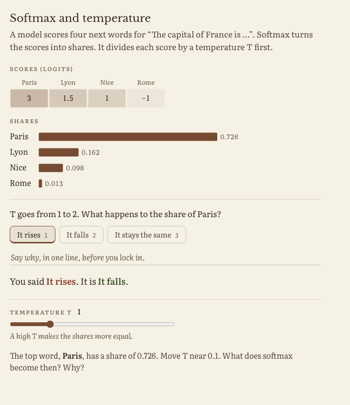 | 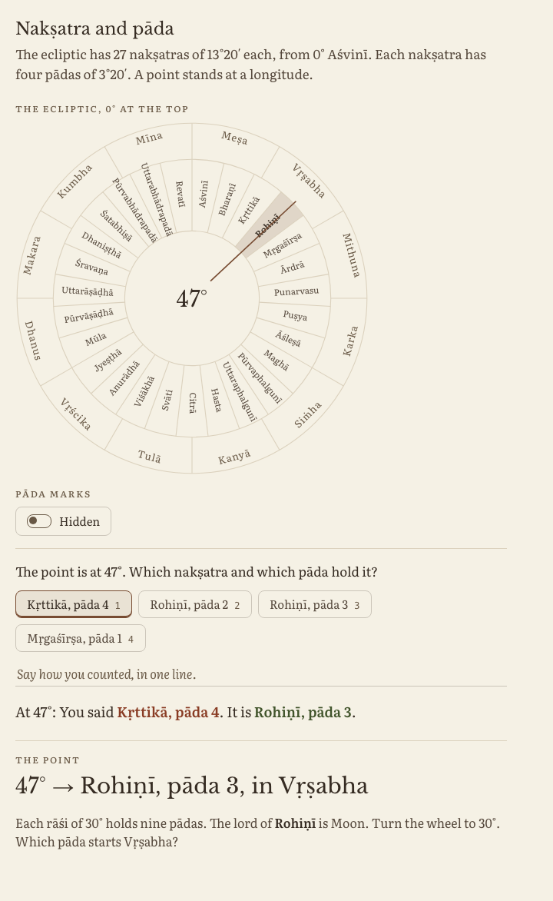 | 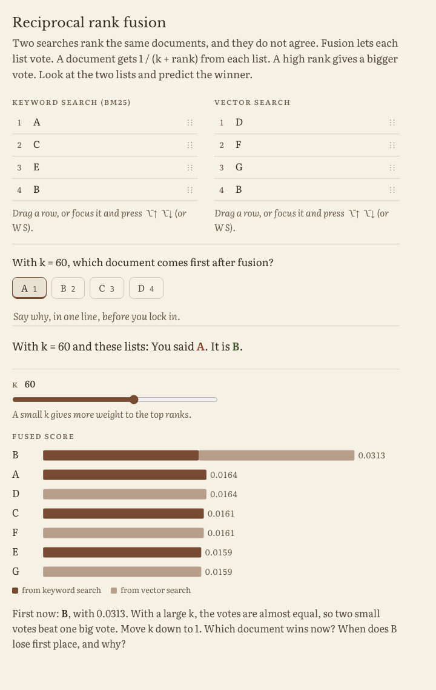 |

| vowel sandhi | diffusion noise |
|----|----|
| 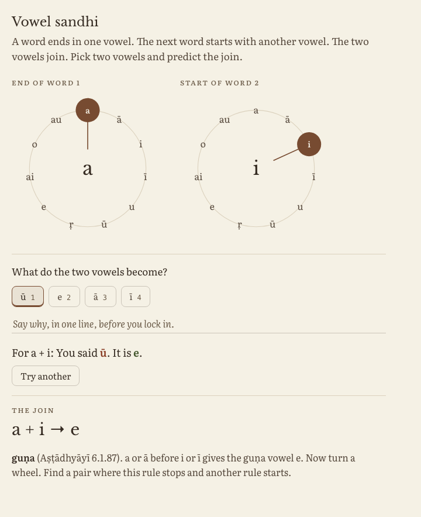 | 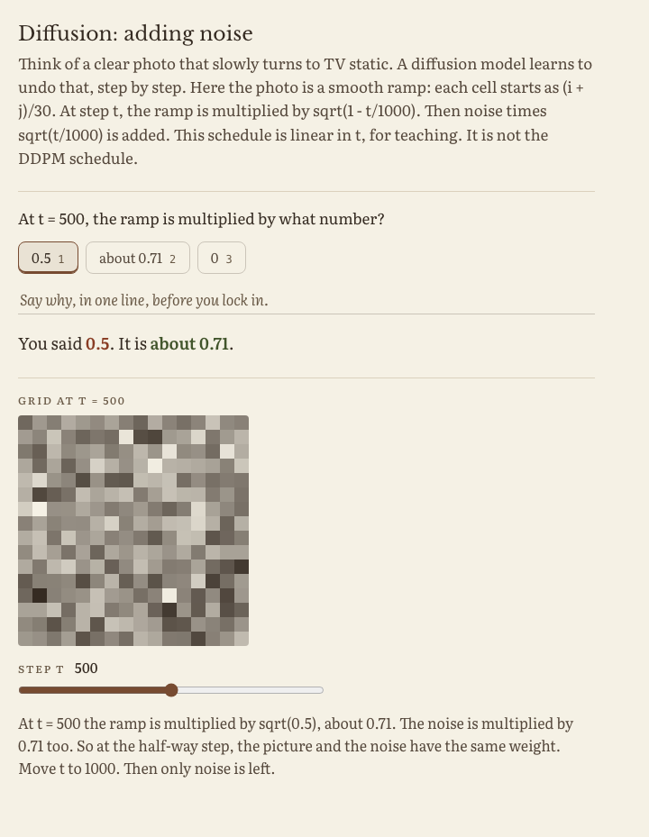 |

## More

### How a demo teaches

A demo never shows the answer first. Each demo follows one loop:

1.  Predict. The demo shows the inputs and asks one question. The result is hidden.
2.  Reveal. The learner locks in with ⌘↩. The demo shows the result and says if the prediction was right.
3.  Manipulate. Now the controls are live. The result changes when the inputs change.
4.  Explain. The caption ends with a new question that the learner answers with the controls.

The validator enforces step 1: a block that shows a value which the answer depends on must wait for the gate.
An explainer is the one exception. It has `"mode": "learn"` and no gate, so it shows a thing at once (see Explainers below).

### What a demo is

A demo is a JSON spec, not code. It has a small state, derived values from named functions (fns), and a list of blocks.
A model can write a spec safely, because a spec cannot run code.

| part | what it is |
|----|----|
| block | a reusable UI part in `rupaka/blocks/<name>/`: its JS, its CSS, a `block.json` manifest and an example |
| fn | a pure function that computes a derived value: [`rules`](https://vedicreader.github.io/rupaka/spec.html#rules), [`rrf`](https://vedicreader.github.io/rupaka/spec.html#rrf), [`softmax`](https://vedicreader.github.io/rupaka/spec.html#softmax), [`lookup`](https://vedicreader.github.io/rupaka/spec.html#lookup), [`expr`](https://vedicreader.github.io/rupaka/spec.html#expr), [`field`](https://vedicreader.github.io/rupaka/spec.html#field), `ids`, `pick`, `sort`, [`fmt`](https://vedicreader.github.io/rupaka/spec.html#fmt) |
| gate | the block that asks for the prediction and hides the result until the lock in |
| spec | the JSON object: `state`, `derive`, `blocks` and `tables`, and a `mode` that is `predict` (the default) or `learn` |

### The host API

A host page can read and change a demo that it mounted. In these calls, `el` is the element that holds the demo: the `[data-rupaka]` element, or the element that you gave to `Rupaka.mount`.

| call | what it does |
|----|----|
| `Rupaka.state(el)` | gives a copy of the input keys (the keys of `spec.state`) and their values |
| `Rupaka.set(el, state)` | sets the input keys that `state` has, then runs `derive` one time and draws one time. It ignores other keys. |
| `Rupaka.options(el, gate)` | gives the option values of the gate [`gate`](https://vedicreader.github.io/rupaka/spec.html#gate), in the order that the gate shows them. Each value is the value itself, not the text that the gate shows. The gate reads options from the state after `derive`, and this call does the same. An unknown gate gives `null`. |
| `Rupaka.settle(el, gate, pick, {answer})` | closes the gate [`gate`](https://vedicreader.github.io/rupaka/spec.html#gate) as if the learner picked `pick`. It draws the verdict and shows the blocks that wait for the gate. With `pick` null, the gate closes with no verdict. An unknown gate does nothing and gives `false`. The options object is optional. |
| `Rupaka.open(el, gate)` | opens the closed gate [`gate`](https://vedicreader.github.io/rupaka/spec.html#gate) again, as the Try another button of the gate does. It removes the pick, the reason and the verdict, and hides the blocks that wait for the gate. It draws one time. It does not move the focus. A gate that is open does not change, and the call gives `true`. A gate that waits for the host to save a prediction does not open, and the call gives `false`. An unknown gate does nothing and gives `false`. |
| `Rupaka.mount(el, spec, {save})` | calls `save(state)` after each change of an input key. `state` is the value that `Rupaka.state(el)` gives. |
| `Rupaka.append(el, block, {into})` | adds one block at the end of the demo, or at the end of the [`stack`](https://vedicreader.github.io/rupaka/spec.html#stack) or [`row`](https://vedicreader.github.io/rupaka/spec.html#row) at the path `into`, with no rebuild. The parts that show stay. It gives the path of the new block, for example `'blocks.3'`. An unknown block type or a bad `into` throws an error. |
| `Rupaka.anchor(el, path)` | gives the element of the block or the part at `path`, or `null`. Each block has `data-rk-id`: its path in the spec, such as `'blocks.2'`. A part adds to it: `'blocks.2.cells.0'`, `'blocks.2.to'`, `'blocks.3.nodes.1'`. The element can be hidden, for example in a later step. |

`Rupaka.set`, `Rupaka.settle` and `Rupaka.open` never send `rk-predict`, never add to `st.log` and never call [`save`](https://vedicreader.github.io/rupaka/render.html#save). `Rupaka.options` only reads. A `lock` does not stop `Rupaka.set`. Each call throws an error when no demo is mounted in `el`.

To show one demo in two windows, mount the spec in each window. Send `Rupaka.state` of the first copy to the second window, and call `Rupaka.set` there. To send a pick, send its index in `Rupaka.options` of the first copy. In the second window, find the value at that index in `Rupaka.options`, and call `Rupaka.settle` with it. When the learner in the first window clicks Try another, call `Rupaka.open` in the second window.

A host can remove the gate answers from the spec of a copy that a room sees, so that the room cannot read them early. Then give the answer to `Rupaka.settle` in `answer`. The gate uses it to draw the verdict. `answer` is `{is: value}` or a path in the state, as in a gate. When the spec has an answer, the gate uses the answer in the spec. Rupaka does not write `answer` into the spec or the state. When the spec has no answer and you give no `answer`, the gate closes with no verdict.

`rupaka.poll` makes a question for a room from a gate. `of_gate(spec, gate)` gives the question and the index of the answer. `public(p)` gives the part that the room sees.

### 3D scenes

A [`scene`](https://vedicreader.github.io/rupaka/spec.html#scene) block draws a physical thing in 3D: a jet that hovers, a gearbox, a molecule. It holds four kinds of part:

| block | what it is |
|----|----|
| [`body`](https://vedicreader.github.io/rupaka/spec.html#body) | a primitive (`box`, `cylinder`, `cone`, `sphere`, `capsule`, `torus`) or a `group`. `in` puts a body in another body, so a compound part moves as one. A state key in `rot` turns it |
| [`force`](https://vedicreader.github.io/rupaka/spec.html#force) | an arrow on a body. Its length is `mag` times the scene scale, so arrows compare. `mag` can be a state key or a derived key |
| [`label3d`](https://vedicreader.github.io/rupaka/spec.html#label3d) | a chip on a point, with a leader line. Chips never overlap: each chip goes to a free place around its point |
| [`shot`](https://vedicreader.github.io/rupaka/spec.html#shot) | a named camera: `wide`, `side`, `front`, `top` or `close:<body id>`. The scene finds the framing from the bounds of what shows |

The scene has a toon look: flat colours in three soft bands, ink outlines, a soft floor and a contact shadow. The colours come from the page theme, in light and dark.
With `bind`, a scene builds one step at a time: a part with `step: n` shows from step n, and the camera moves to the newest shot. With `prefers-reduced-motion`, the camera cuts and parts show at once.
The think rule holds: a force or a label that shows the answer of a gate must wait for the gate.

rupaka keeps a copy of three.js (0.185.0, MIT) in `rupaka/static/vendor/three/`. It loads only for a spec that has a scene, and never from a CDN:

- [`page`](https://vedicreader.github.io/rupaka/render.html#page), [`save`](https://vedicreader.github.io/rupaka/render.html#save), [`show`](https://vedicreader.github.io/rupaka/render.html#show) and `md(frame=True)` put three.js in the page when a spec has a scene, so the page works offline and from `file://`.
- A server that serves the runtime at a prefix also serves `bundle('three')` as `three.js` at that prefix, beside `rupaka.js`. The runtime loads it from there the first time that a scene mounts. A host that serves it at another place sets `Rupaka.base` before the first scene mounts.

#### Scenes and the board

The board of the screen guide speaks one line for each step. It drives a scene with the host API, so “again”, “slower” and “next” need no new code:

| board operation | host call |
|----|----|
| `{"op": "step", "n": 3}` with a scene spec | `Rupaka.set(el, {step: 3})`, where `step` is the `bind` of the scene |
| `{"op": "demo", "set": {...}}` | `Rupaka.set(el, {...})`, for example a slider value or a step |
| `{"op": "cam", "shot": "side"}` | `Rupaka.cam(el, 'side')`. It sets the key that a [`shot`](https://vedicreader.github.io/rupaka/spec.html#shot) block binds. It gives `false` for a bad name, or when the scene has no bound shot |

`shots(spec)` gives the shot names that a spec knows, so a host can check a `cam` operation before it draws. Each scene element also tells its state: `data-rk-shot` is the shot now, and `data-rk-still` is `1` when nothing moves.

#### Explainers

Sometimes the learner must see a thing before there is a good question, for example how a jet hovers. An explainer shows a scene at once, with no prediction step.
Set `"mode": "learn"` on the spec. Then [`validate`](https://vedicreader.github.io/rupaka/spec.html#validate) lets the spec have no gate. All the other checks still run.

- An explainer cannot have a gate, and no block can wait for a gate or lock to a gate. [`validate`](https://vedicreader.github.io/rupaka/spec.html#validate) refuses each one and says what to remove.
- With no `mode`, or with `"mode": "predict"`, a spec with no gate is refused as before. A `mode` that is not `predict` or `learn` is refused.
- The runtime shows a small “Explainer” label above the title, so the learner knows that there is no prediction step. The `.rk` element has `data-rk-mode="learn"`.

``` python
ex = demo('box', 'A box', mode='learn', state=dict(step=1), blocks=[scene(body('b', 'box', [1, 1, 1]), bind='step', steps=['A box.'])])
```

#### Panels that build with a voice

A board panel shows a worked example one row at a time, while a voice speaks. Use an explainer with the state key `step`:

- A block with `"step": n` shows when the step is `n` or more, and draws in from the left. The host moves on with `Rupaka.set(el, {step: n})`.
- A [`pair`](https://vedicreader.github.io/rupaka/spec.html#pair) is one row: input cells, an arrow and the answer, for example `[18] → 47`. Its cells come in one by one, 80 ms apart.
- A [`flow`](https://vedicreader.github.io/rupaka/spec.html#flow) is two to five nodes with at most eight arrows, in a [`row`](https://vedicreader.github.io/rupaka/spec.html#row) or a `cycle`.
- A server can stream the panel. It sends the start of the spec, then one block at a time. `append(spec, block)` checks each block in Python, and `Rupaka.append(el, block)` adds it in the page.
- `Rupaka.anchor(el, path)` gives the element of a part, so the board can draw a curve from a mark on the page to that part.
- `theme='paper'` on [`host`](https://vedicreader.github.io/rupaka/render.html#host), [`page`](https://vedicreader.github.io/rupaka/render.html#page) or [`Demo`](https://vedicreader.github.io/rupaka/render.html#demo) (the attribute `data-rk-theme="paper"`) gives a warm paper ground, light boxes, sketch lines and a hand font, Patrick Hand (OFL).

### The screen-guide board

`rupaka.board` is the board of the screen guide. A learner says “I don’t get X”, and a model answers with a board: one short spoken
line for each step, and marks on the page (a circle, a box, an arrow, a label, a sketch on a figure) and a small worked example in a
side panel. abhyasa and Leela both use it.

- The model writes JSON lines in a closed language (`OPS`). `parse_board(text, ctx)` checks each line against the page context: a
  bad line drops, and two bad lines in a row end the board. The model never sends HTML, script or a link.
- `clean_context(raw)` keeps only the known keys of what the page sends (its anchors, the focus, the thread and the demo) and cuts them to size.
- `stream_board(chunks, ctx, on_step)` gives each step to the page as soon as it is whole.
- `static/board.js` draws a checked board as `window.rupakaBoard.play(board)`. The side panel is on the paper of the demos, in the hand font.
  A host serves `bundle('js')`, `bundle('css')` and the pen libraries in `assets().libs`.

The decisions about learning (when the tutor is sure, which sources to trust, the prompts) stay in the app.

### Develop

The notebooks in `nbs/` are the source of the Python. The JS and CSS are hand-written files under `rupaka/static/`, `rupaka/blocks/` and `rupaka/fns/`.

``` sh
uv sync
uv run nbdev-prepare
uv run pytest
```
